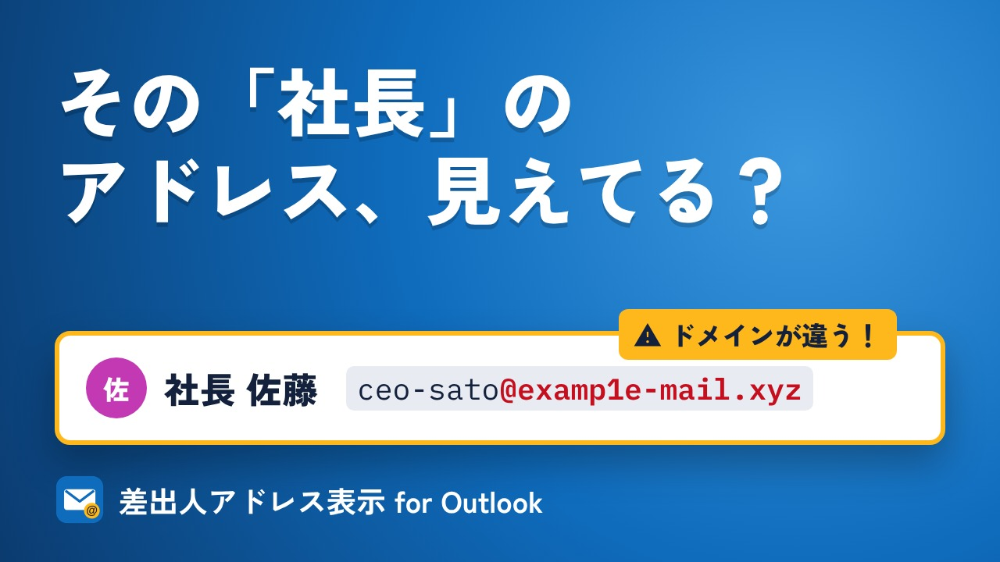

# 差出人アドレス表示 for Outlook

**Sender Address Viewer for Outlook** — Outlook on the web で差出人名の横にメールアドレスを常に表示する Chrome 拡張機能。

紹介動画：[日本語](https://youtu.be/o5nKh7ymOpU) / [English](https://youtu.be/Kz3tHvdSppU) ・ 公式サイト：https://kat-log.github.io/outlook-sender-address/

対応: `outlook.office.com` / `outlook.office365.com` / `outlook.live.com` / `outlook.cloud.microsoft`

Outlook Web は標準では差出人名しか出さず、アドレスはホバーしないと見えません（設定でも変更不可）。

## 機能

- **開いたメール**: 閲覧ウィンドウの差出人名の右にアドレスを表示（既定 ON）
- **メール一覧**: 受信トレイ各行の差出人名の右にアドレスを表示（既定 OFF、ポップアップで切替）
- アドレスのドメイン部分を太字表示（なりすまし確認用）
- バッジをクリックでアドレスをコピー

## インストール（開発版）

1. `chrome://extensions` を開き「デベロッパーモード」を ON
2. 「パッケージ化されていない拡張機能を読み込む」でこのフォルダを選択
3. Outlook Web をリロード

## 仕組み

| 場所 | アドレスの取得元 |
| --- | --- |
| メール一覧 | 差出人 `` の `title` 属性 |
| 閲覧ウィンドウ | DOM に無いため、`[id$="_FROM"]` 要素の React fiber props（`sender.Mailbox.EmailAddress` 等） |

React の内部データを読むため、`content-main.js` は `world: "MAIN"` で動作します。設定は `content-bridge.js`（isolated world）が `chrome.storage.sync` から読み、`<html data-osa-*>` 属性経由で渡します。

Outlook 側の DOM 変更で動かなくなる可能性があります。その場合は上記セレクタを見直してください。

## プライバシー

データの収集・送信は一切行いません。詳しくは [PRIVACY.md](PRIVACY.md) を参照してください。

## 免責

Microsoft および Outlook は Microsoft Corporation の商標です。本拡張機能は Microsoft とは無関係の非公式ツールです。

## ストア掲載素材

`store/` にスクリーンショット（1280×800）、プロモタイル（440×280）、掲載文（`LISTING.md`）があります。拡張機能本体のパッケージには含めません。
